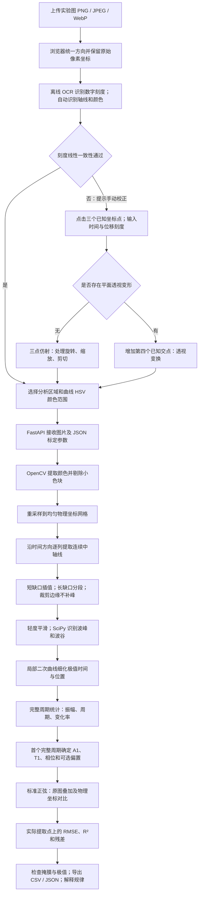

# 弹簧振子图像分析：教学工作台

**Streamlit 部署：选择 `xushuodawawang/spring-oscillator-lab` → `main` → `streamlit_app/app.py`，Python 3.12。无需 API Key。** [查看三步部署说明](STREAMLIT.md) · [打开 Streamlit](https://share.streamlit.io)

本地体验：`python -m pip install -r streamlit_app/requirements.txt`，然后 `python -m streamlit run streamlit_app/app.py`。教学界面与 Win7 学生简洁版一致，云端入口只依赖 Streamlit，图片处理在浏览器内完成。

当前 Win7 学生简洁版：`dist/win7/SpringOscillatorLab-Win7-v1.2.exe`。上传即分析；红色实验曲线与鲜明蓝色标准波对比。主页面逐个显示完整振动的周期、振幅、相对上次和首次的变化，以及平均位移差和结论；专业设置和计算详情默认收起。`student-display.js` 的代码同时内嵌在 `index.html`，通过 `win7/test_student_readings.cjs` 验证读数和两份代码的一致性。

**Windows 7 请使用 `dist/win7/SpringOscillatorLab-Win7.exe` 或同目录 HTML，说明见 `dist/win7/使用说明.md`。** 该版本采用浏览器离线计算和32位启动器，保留自动识别、手动/透视校正与逐周期比较；无需 Python。完整版 v1.2 的 Python 3.12 EXE 不支持 Win7。

**是的，必须建立物理坐标系（像素到物理单位的映射）。** 粉色像素本身没有“秒”或“厘米”的含义。v1.2 默认上传后自动识别坐标轴、数字刻度与曲线颜色，并以多个刻度的一致性检查建立坐标映射。自动识别不可靠时，使用“颜色提取波形曲线＋交互式手动标定坐标轴”。教师和学生可以查看自动标记、复核数据。

## 1. 系统架构与工作流



| 层 | 文件 | 职责 |
|---|---|---|
| 前端 | `index.html` | HTML、CSS、JS 整合在一个文件中；图片点击标定、放大、取色、框选 ROI、Canvas 图表、数据导出 |
| Web 后端 | `app.py` | FastAPI 接口、图片上传、错误反馈、静态页面、合成教学示例 |
| 测量与分析 | `analysis.py` | OpenCV 坐标变换及颜色提取，NumPy 数组计算，SciPy 极值识别与逐周期统计 |
| 自动标定 | `auto_calibration.py` | 本地 OCR 数字识别、网格定位、多刻度一致性检查、自动坐标与颜色设置 |
| 桌面入口 | `launcher.py` | EXE 本地服务、自动打开浏览器、可退出的桌面控制窗口 |
| 打包 | `build.ps1` | 建立独立虚拟环境、运行测试、生成单文件 EXE |
| 校验 | `tests/test_analysis.py` | 对照已知真值检验正弦、衰减、旋转、透视、缺口、裁剪及 API |

前端使用原生 Canvas，无需 CDN 或联网加载图表库。上传图片不持久保存，不发送到外部 AI 服务。EXE 只监听 `127.0.0.1`。

## 2. EXE 使用步骤

1. 在 `dist` 目录双击 `SpringOscillatorLab-v1.2.exe`。应用自带 Python、科学计算库及 OCR 模型，使用时无需另装 Python 或联网。
2. 启动后出现控制窗口并打开默认浏览器；如果没有打开，点击控制窗口中的“打开分析页面”。
3. 保持默认勾选“上传后自动标定并分析”，上传实际图片，等待结果；无需点击坐标点或分析按钮。“加载教学示例”也会自动分析。
4. 检查自动标记、提取点及结果表。没有明确的位移单位时，振幅显示“纵轴单位”；可填真实单位后点击“自动识别并分析”。
5. 自动失败时，根据中文提示手动校正：依次点击交点 `(0,0)`、时间刻度 `(5,0)`、位移刻度 `(0,1)`。刻度值须按实际图像填写。
6. 如果是斜拍的平面图片，启用四点透视校正，增加同一网格上的 `(5,1)` 点。
7. 框选图中曲线所在区域，完整保留峰谷，排除同色图例与无关文字。可点击曲线内部取色，也可手工输入 HSV 阈值。
8. 点击“分析实验波形”，先检查原图青色提取点、蓝色标准波和二值掩膜，再检查峰谷位置。
9. 查看每个周期的振幅、周期、变化率和残差。可导出周期 CSV、采样 CSV、完整 JSON。
10. 关闭桌面控制窗口或点击“退出程序”以停止服务。仅关闭浏览器不会退出服务。

单文件模式启动时会将依赖解包到系统临时目录，首次启动可能需等待数秒。发布文件为 Windows x64 版本，未进行代码签名。启动错误日志在 `%LOCALAPPDATA%\SpringOscillatorLab\spring-lab.log`。

v1.2 优先使用固定地址 `http://127.0.0.1:8766/`。重复打开会复用同一服务；该端口被其他程序占用时，会选择空闲端口，以控制窗口显示的地址为准。页面顶部显示连接状态。若未连接，请从 EXE 控制窗口重新打开页面；不要单独打开 `index.html` 或把离线报告当作分析入口。分析期间须保持控制窗口开启。

## 3. 从源代码运行

推荐 Python 3.12。在本项目目录运行 PowerShell：

```powershell
py -3.12 -m venv .venv
.\.venv\Scripts\python.exe -m pip install -r requirements.txt
.\.venv\Scripts\python.exe -m uvicorn app:app --host 127.0.0.1 --port 8000
```

打开 [本地实验工作台](http://127.0.0.1:8000/)。在终端按 `Ctrl+C` 停止。

也可以运行桌面入口：

```powershell
.\.venv\Scripts\python.exe launcher.py
```

### 重新打包

```powershell
powershell -NoProfile -ExecutionPolicy Bypass -File .\build.ps1
```

生成 `dist\SpringOscillatorLab-v1.2.exe`。脚本先运行全部物理分析测试，测试失败会停止打包。项目提供 `requirements-lock.txt` 固定已验证的依赖版本；存在该文件时打包脚本优先使用它。首次安装依赖需要网络；生成的 EXE 日常运行不需要网络。Windows EXE 须在 Windows 上构建。

### 测试

```powershell
.\.venv\Scripts\python.exe -m pip install -r requirements-dev.txt
.\.venv\Scripts\python.exe -m unittest discover -s tests -v
```

打包后还可以验证 EXE 本身（测试期间 8765 端口须空闲）：

```powershell
.\.venv\Scripts\python.exe tests\smoke_exe.py
```

它在独立临时目录中运行 EXE，移除 Python 路径环境变量，检查内置网页、手动分析、无标定参数的自动 OCR 分析、正常退出及桌面控制窗口。

## 4. 坐标标定怎样转换为物理量

三点标定输入像素位置 `P0=(u0,v0)`、`PX=(ux,vx)`、`PY=(uy,vy)`，对应物理坐标 `(t0,y0)`、`(tx,y0)`、`(t0,yy)`。`cv2.getAffineTransform` 求解 2×3 矩阵，扩展为 3×3 矩阵 H：

```text
[t, y, 1]ᵀ = H × [u, v, 1]ᵀ
```

对横平竖直的普通图像，它等价于：

```text
t = t0 + (u-u0) × (tx-t0)/(ux-u0)
y = y0 + (v-v0) × (yy-y0)/(vy-v0)
```

图片的 v 向下增长，物理位移通常向上增长；Y 刻度标定自然包含这个符号，不应再随意翻转。

四点标定增加 `(tx,yy)` 的像素位置，使用 `cv2.getPerspectiveTransform` 求 H，再将齐次坐标除以第三个分量。后端**先校正到等间隔的时间—位移网格，再逐列提取**。倾斜图片中，同一像素列不一定对应同一时刻。

为限制内存，校正网格最多 2400 列×1400 行。页面显示重采样间隔 Δt、Δy，以及区域中心每像素对应的局部物理量级。这些仅表示分辨率，不能当作完整不确定度。

## 5. 波形提取、极值和完整周期

OpenCV 将图片转换为 HSV；通过 Hue 范围、饱和度下限、亮度下限提取曲线。黑色轴线和灰色网格通常饱和度低，可被排除。Hue 的 OpenCV 范围为 0–179；下界大于上界时按跨越 179/0 的区间处理。

小连通色块按面积剔除。逐列将连续的曲线色块取中位位置作为中轴；一列出现多个色块时优先延续前一列的位置，并显示多色块警告。**这不是对任意图片都可靠的自动识别**：同色图例、第二条同色曲线、复杂遮挡仍须通过 ROI 与预览核查。

短缺口可以线性插值，长缺口必须分段。平滑使用 Savitzky–Golay；波峰使用 `find_peaks(y)`，波谷使用 `find_peaks(-y)`。再对极值附近作局部二次曲线定位，减轻粗线条、平顶与像素量化引起的时间偏移。它不进行整段正弦拟合。

参数建议：同类极值最小间距小于预计周期、远大于噪声峰间距；突出度小于实际峰谷差；平滑窗口远小于一个周期的采样点数。位移单位变化后，突出度也应随之调整。

一个完整周期要求：两个相邻同类极值，中间恰有一个反向极值，且没有长缺口或边缘截断。程序在波峰周期和波谷周期中选择**最早可验证的完整周期**作为第1周期，此后统一使用同一种边界；不会把两种周期同时列出而造成重叠。图像端点无法确认是否为真正极值，不作为周期边界。

```text
Ti = t(后一个同类极值) − t(前一个同类极值)
Ai = (峰值 − 谷值)/2
```

对峰→峰周期，两个边界峰取平均，再与中间谷作差除以 2；对谷→谷周期，两个边界谷取平均，再与中间峰作差除以 2。这样缓慢衰减时不会任意偏向左端或右端。峰、谷和中线数值都保存在 JSON 中，便于复核。这是**该周期的代表振幅**，不是某一瞬间的衰减包络值。

## 6. 标准函数与误差指标

默认严格以 y=0 为平衡位置：

```text
y_standard(t) = A1 × sin(2πt/T1 + φ)
```

角频率是 `2π/T1`，不是 `2π×T1`。

若首周期从波峰时刻 tp 开始，`φ=π/2−2πtp/T1`；若从波谷 tv 开始，`φ=−π/2−2πtv/T1`。程序将相位规范到 `[-π,π)`。

若实验的平衡位置确实不在零点，可勾选“首周期中线偏置”，使用：

```text
C1 = (首周期代表峰值 + 首周期代表谷值)/2
y_standard(t) = C1 + A1 × sin(2πt/T1 + φ)
```

偏置会明确显示在函数中。所有参数均来自第1个完整周期，**不会利用后续周期重新拟合或隐藏偏差**。整段图像与首周期分别计算：

```text
RMSE = sqrt(mean((y_observed − y_standard)²))
R² = 1 − Σ(y_observed − y_standard)² / Σ(y_observed − mean(y_observed))²
```

RMSE 具有位移单位；R² 可以为负，实际位移完全无变化时分母为零，显示“—”。计算只使用有实际提取值且属于有效分析段的采样点；插值点不进入误差指标。页面同时列出样本数与 RMSE/A1，以便解释尺度。采样 CSV 中的实际提取、平滑、标准值、残差和是否实测列相互独立。

逐周期变化率为：

```text
振幅变化率 = (Ai/A1 − 1) × 100%
振幅衰减率 = (1 − Ai/A1) × 100%
周期变化率 = (Ti/T1 − 1) × 100%
```

摘要报告振幅是否按当前测量值逐周期不增、末周期的累计衰减、平均周期和周期变异系数。仅一个完整周期时，不下变化规律结论。图像误差也可能造成小幅波动，不自动把单调性判定当成阻尼的证明。

## 7. 特别说明：图片透视和裁剪误差

| 问题 | 本项目处理 | 教学建议 |
|---|---|---|
| 普通缩放、旋转、剪切 | 三点仿射标定并重采样 | 尽量使用原始导出图，校准点选择较远的刻度 |
| 拍摄平面图导致的透视 | 增加第四个已知交点作透视校正 | 不要凭图片外框猜物理坐标；第四点必须是已知网格交点 |
| 裁掉原点、但还有已知刻度 | 输入非零 t₀、y₀，标定一个已知交点 | 不能把裁剪左边缘冒充 t=0；保留真实时间基准 |
| 裁掉首尾半周期 | 排除不完整周期，报告最早可验证完整周期 | “第1周期”可能不是实际运动开始后的第1次振动 |
| 裁掉波峰/波谷 | 接触 ROI 上下边缘的列禁止插值；相关周期排除 | 被剪掉的振幅无法从截图恢复，应扩大 ROI 或重新取得完整图 |
| 长遮挡、颜色识别断裂 | 分段识别，禁止跨长缺口计算周期 | 检查缺口原因；有效周期编号不代表没有遗漏振动 |
| 镜头桶形畸变、弯曲纸张、非线性坐标轴 | 单一仿射/透视模型不能校正 | 优先换用平整扫描或原始数据；需另行镜头标定或非线性坐标映射 |

仍须人工检查：曲线贴边却没有颜色像素接触边界的截断、错误点击的刻度、同色大面积图例等不一定能自动检测。相关注释也写在 `analysis.py` 中。

进行误差讨论时，可把各标定点偏移±1–2像素重新分析，比较 A1、T1 和 RMSE 的变化，再讨论时间刻度精度、线条宽度、平滑参数和真实实验误差。不能将截图中的小变化直接解释成物理效应。

## 8. 教学验证示例

合成示例的已知生成函数为 `y(t)=exp(-0.045t)sin(πt+0.25) cm`，理论周期为 2 s。运行后应看到：周期接近 2 s、振幅逐渐减小、全图 RMSE 大于首周期 RMSE。标准波保持首周期的振幅不变，因此偏差随衰减显现。

测试还使用无衰减的 `sin(πt+0.25)` 对照，以及独立施加的旋转、剪切与透视变换，验证标定后能恢复已知振幅和周期。真实实验图片仍需要教师检查预览；合成测试不能替代实验数据核查。

## 9. API 与官方技术资料

`POST /api/auto-analyze` 只需 multipart 图片字段 `file`，可选 `unit` 和 `include_offset`；返回额外的 `automatic` 字段，记录识别到的刻度与拟合残差。自动模式要求横平竖直的线性轴、每轴至少3个可靠数字刻度，且刻度覆盖范围充足。斜拍、对数轴、科学计数法刻度、刻度被裁掉或多条显著彩色曲线需手动校正。未知时间单位按秒计算并明确提示；未知位移单位保留“纵轴单位”，不猜测厘米或米。

`POST /api/analyze` 使用 multipart 表单，字段为 `file`（图片）和 `settings`（JSON字符串）。参数定义见 `analysis.py` 的 `Settings`。坐标均使用原图像素。返回 `cycles`、`standard`、`metrics`、`data`、`calibration`、`preview`、`warnings` 和原始设置；非法图片或退化标定返回可读错误。

- [FastAPI：表单与文件同时上传](https://fastapi.tiangolo.com/tutorial/request-forms-and-files/)
- [OpenCV：HSV 颜色范围提取](https://docs.opencv.org/4.x/da/d97/tutorial_threshold_inRange.html)
- [OpenCV：仿射、透视和重采样变换](https://docs.opencv.org/4.x/da/d54/group__imgproc__transform.html)
- [SciPy：find_peaks 极值检测](https://docs.scipy.org/doc/scipy/reference/generated/scipy.signal.find_peaks.html)
- [PyInstaller：单文件打包与附加数据](https://pyinstaller.org/en/stable/usage.html)

AI 为教学提供可复核的测量流程；物理规律的判断来自坐标标定、数据质量和实验验证。
